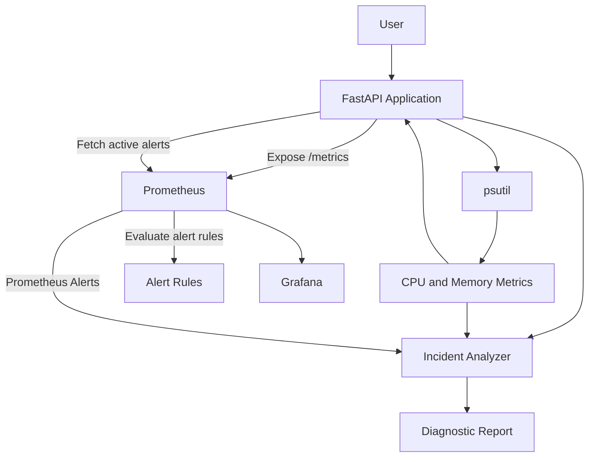

# CloudOps Sentinel

**Infrastructure Health Monitoring and Incident Diagnostics Platform**

CloudOps Sentinel is a containerized infrastructure monitoring and diagnostics platform built with Python, FastAPI, Prometheus, and Grafana.

It collects system-level metrics, monitors infrastructure health, evaluates alert conditions, and generates rule-based diagnostic reports to help identify potential infrastructure issues.

## Features

- **System Monitoring:** Collects CPU and memory utilization using `psutil`.
- **REST API:** Exposes infrastructure health and diagnostic endpoints using FastAPI.
- **Prometheus Integration:** Exposes application metrics and retrieves active Prometheus alerts.
- **Alert Detection:** Evaluates CPU and memory thresholds.
- **Incident Analysis:** Generates diagnostic findings with possible causes, investigation steps, and recommended actions.
- **Containerization:** Runs services using Docker and Docker Compose.
- **Automated Testing:** Includes unit and integration-oriented tests using pytest.
- **CI Pipeline:** Uses GitHub Actions to run tests and build the Docker image.

## Architecture

CloudOps Sentinel consists of three main services:

| Component | Responsibility |
|---|---|
| FastAPI | Collects system metrics and provides REST APIs |
| Prometheus | Scrapes application metrics and evaluates alert rules |
| Grafana | Provides the visualization interface for infrastructure metrics |

### System Workflow

1. FastAPI collects CPU and memory metrics from the host/container.
2. Prometheus periodically scrapes metrics from the FastAPI `/metrics` endpoint.
3. Prometheus evaluates configured alert rules.
4. FastAPI retrieves active alerts through the Prometheus HTTP API.
5. The Incident Analyzer combines local system metrics and Prometheus alerts to generate diagnostic findings.
6. Grafana is included as the visualization service for monitoring metrics.

All services run locally using Docker Compose.

## API Endpoints

CloudOps Sentinel exposes the following REST API endpoints:

| Method | Endpoint | Description |
|---|---|---|
| GET | `/` | Returns project information and application status |
| GET | `/health` | Checks application health |
| GET | `/metrics/system` | Returns current CPU and memory utilization with CPU alert status |
| GET | `/metrics` | Exposes metrics in Prometheus format |
| GET | `/analyze` | Generates an incident diagnostic report using system metrics and Prometheus alerts |

### Example API Usage

Check application health:

```bash
curl http://localhost:8000/health
```

Retrieve system metrics:

```bash
curl http://localhost:8000/metrics/system
```

Generate an incident analysis report:

```bash
curl http://localhost:8000/analyze
```

Access Prometheus metrics:

```bash
curl http://localhost:8000/metrics
```

## Installation and Local Setup

### Prerequisites

Make sure the following tools are installed:

- Git
- Docker
- Docker Compose

### 1. Clone the repository

```bash
git clone https://github.com/meowphilops/cloudops-sentinel.git
cd cloudops-sentinel
```

### 2. Build and start services

```bash
docker compose up -d --build
```

This command builds the FastAPI application image and starts the API, Prometheus, and Grafana containers in the background.

### 3. Verify running containers

```bash
docker compose ps
```

### 4. Access the services

| Service | URL |
|---|---|
| FastAPI | http://localhost:8000 |
| API Documentation | http://localhost:8000/docs |
| Prometheus | http://localhost:9090 |
| Grafana | http://localhost:3000 |

### 5. Stop the services

```bash
docker compose down
```

To remove persistent monitoring data as well:

```bash
docker compose down -v
```

**Note:** Removing volumes permanently deletes the stored Prometheus and Grafana data.

## Testing

CloudOps Sentinel uses `pytest` for automated testing.

The test suite covers:

- API endpoint responses.
- CPU alert threshold evaluation.
- Incident analysis logic.
- Prometheus client error handling.
- Prometheus alert integration behavior.

### Run tests locally

Create and activate a virtual environment:

```bash
python3 -m venv .venv
source .venv/bin/activate
```

Install development dependencies:

```bash
pip install -r requirements-dev.txt
```

Run the test suite:

```bash
python -m pytest -v
```

## Continuous Integration

GitHub Actions automates the project's quality checks whenever code is pushed to the `main` branch or a pull request is opened.

The CI workflow:

1. Checks out the repository.
2. Sets up Python 3.12.
3. Installs project dependencies.
4. Runs automated tests.
5. Builds the Docker image.

This helps detect application and container build issues before changes are merged.

### Architecture Diagram


