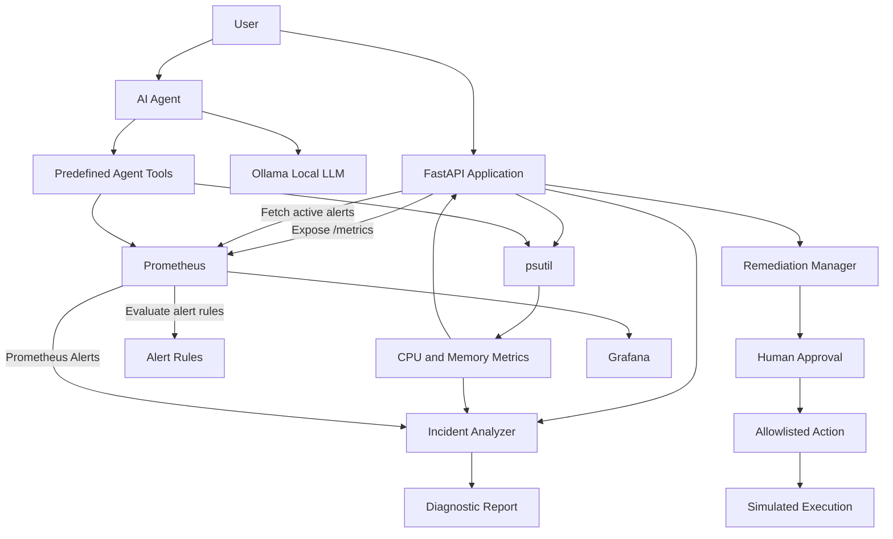

# CloudOps Sentinel

**Infrastructure Health Monitoring, AI-Assisted Diagnostics and Human-Approved Remediation Platform**

CloudOps Sentinel is a containerized infrastructure monitoring and diagnostics platform built with Python, FastAPI, Prometheus, Grafana, and a locally running LLM.

It collects system-level metrics, monitors infrastructure health, evaluates alert conditions, and generates diagnostic reports. It also integrates an AI-powered agent for infrastructure investigation and a human-approved remediation workflow for controlled corrective actions.

The project demonstrates infrastructure monitoring, observability, AI-assisted operations, and safe remediation practices in a local development environment.

## Features

- **System Monitoring:** Collects CPU and memory utilization using `psutil`.
- **REST API:** Exposes infrastructure health, metrics, diagnostics, and remediation endpoints using FastAPI.
- **Prometheus Integration:** Exposes application metrics and retrieves active Prometheus alerts.
- **Alert Detection:** Evaluates CPU utilization thresholds.
- **Incident Analysis:** Generates diagnostic findings, possible causes, investigation steps, and recommended actions.
- **Agentic AI:** Integrates a locally running LLM through Ollama for infrastructure investigation and controlled tool calling.
- **Agent Tools:** Allows the AI agent to retrieve CPU, memory, and Prometheus alert information through predefined tools.
- **Human-Approved Remediation:** Supports proposing, approving, and rejecting remediation actions through REST APIs.
- **Safe Execution:** Uses an allowlist of remediation actions and prevents duplicate execution of processed proposals.
- **Containerization:** Runs the API, Prometheus, and Grafana using Docker Compose.
- **Automated Testing:** Includes unit and integration-oriented tests using pytest.
- **CI Pipeline:** Uses GitHub Actions to run tests and build the Docker image.

## Architecture

CloudOps Sentinel consists of the following components:

| Component | Responsibility |
|---|---|
| FastAPI | Provides infrastructure monitoring and remediation REST APIs |
| psutil | Collects CPU and memory metrics |
| Prometheus | Scrapes application metrics and evaluates alert rules |
| Grafana | Provides the monitoring visualization service |
| Incident Analyzer | Generates rule-based diagnostic reports |
| Ollama | Runs the local LLM used by the AI agent |
| AI Agent | Investigates infrastructure using predefined tools |
| Remediation Manager | Manages human-approved remediation proposals |

### System Workflow

1. FastAPI collects CPU and memory metrics using `psutil`.
2. Prometheus periodically scrapes metrics from the FastAPI `/metrics` endpoint.
3. Prometheus evaluates configured alert rules.
4. FastAPI retrieves active alerts through the Prometheus HTTP API.
5. The Incident Analyzer combines system metrics and Prometheus alerts to generate diagnostic findings.
6. The AI agent uses a locally running LLM through Ollama to investigate infrastructure information and invoke predefined monitoring tools.
7. The Remediation Manager accepts remediation proposals and waits for human approval before executing an allowlisted action.
8. Grafana is included as the monitoring visualization service.

Monitoring services run locally using Docker Compose. Ollama and the AI agent run separately on the local development machine.

### Architecture Diagram



## API Endpoints

### Monitoring and Diagnostics

| Method | Endpoint | Description |
|---|---|---|
| GET | `/` | Returns application information |
| GET | `/health` | Checks application health |
| GET | `/metrics/system` | Returns CPU and memory metrics |
| GET | `/metrics` | Exposes metrics in Prometheus format |
| GET | `/analyze` | Generates an incident diagnostic report using system metrics and Prometheus alerts |

### Human-Approved Remediation

| Method | Endpoint | Description |
|---|---|---|
| POST | `/remediation/propose` | Creates a remediation proposal |
| GET | `/remediation/pending` | Lists proposals awaiting approval |
| POST | `/remediation/{proposal_id}/approve` | Approves and executes a pending proposal |
| POST | `/remediation/{proposal_id}/reject` | Rejects a pending proposal |

### Example API Usage

Check application health:

```bash
curl http://localhost:8000/health
```

Retrieve system metrics:

```bash
curl http://localhost:8000/metrics/system
```

Generate an incident report:

```bash
curl http://localhost:8000/analyze
```

Access Prometheus metrics:

```bash
curl http://localhost:8000/metrics
```

### Remediation Workflow Example

Create a remediation proposal:

```bash
curl -X POST http://localhost:8000/remediation/propose \
  -H "Content-Type: application/json" \
  -d '{
    "action": "restart_demo_service",
    "reason": "Demonstrating human-approved remediation."
  }'
```

List pending proposals:

```bash
curl http://localhost:8000/remediation/pending
```

Approve a proposal:

```bash
curl -X POST http://localhost:8000/remediation/<PROPOSAL_ID>/approve
```

Reject a proposal:

```bash
curl -X POST http://localhost:8000/remediation/<PROPOSAL_ID>/reject
```

The remediation manager supports proposal states such as `pending`, `executing`, `executed`, `rejected`, and `failed`.

Only allowlisted actions can be proposed. Processed proposals cannot be approved again.

**Note:** The currently implemented `restart_demo_service` action is simulated. It does not restart an actual host or container service.

## Installation and Local Setup

### Prerequisites

Make sure the following tools are installed:

- Git
- Python 3
- Docker
- Docker Compose
- Ollama (for the local AI agent)

### 1. Clone the repository

```bash
git clone https://github.com/meowphilops/cloudops-sentinel.git
cd cloudops-sentinel
```

### 2. Build and start monitoring services

```bash
docker compose up -d --build
```

Verify running services:

```bash
docker compose ps
```

### 3. Access services

| Service | URL |
|---|---|
| FastAPI | http://localhost:8000 |
| API Documentation | http://localhost:8000/docs |
| Prometheus | http://localhost:9090 |
| Grafana | http://localhost:3000 |
| Ollama API | http://localhost:11434 |

Grafana is included as the monitoring visualization service. Dashboard and datasource configuration may require additional setup.

### 4. Local AI Agent Setup

Install Ollama and pull a supported local model.

For example:

```bash
ollama pull qwen2.5:3b
```

Make sure the Ollama service is running before using the AI agent.

The agent communicates with Ollama's local API and uses predefined tools for infrastructure investigation. It runs separately from the FastAPI application.

### 5. Stop the services

```bash
docker compose down
```

## Testing

The project uses pytest for automated testing.

The test suite covers:

- API endpoint responses.
- CPU alert threshold evaluation.
- Incident analysis logic.
- Prometheus client behavior and error handling.
- Agent tool execution and validation.
- AI agent orchestration and tool-calling behavior.
- Remediation proposal creation and validation.
- Approval, rejection, and execution failure handling.
- Duplicate and concurrent approval protection.

### Run tests locally

Create and activate a virtual environment:

```bash
python3 -m venv .venv
source .venv/bin/activate
```

Install dependencies:

```bash
pip install -r requirements.txt
pip install -r requirements-dev.txt
```

Run the test suite:

```bash
python -m pytest -v
```

The current test suite contains **69 passing tests**.

## Continuous Integration

GitHub Actions automates the project's quality checks whenever code is pushed to the `main` branch or a pull request is opened.

The CI workflow:

- Sets up the Python environment.
- Installs project dependencies.
- Runs automated tests.
- Builds the Docker image.

This helps detect application and container build issues before changes are merged.

## Project Limitations

- The project currently runs in a local development environment.
- The AI agent uses a locally hosted LLM through Ollama.
- Remediation execution is currently simulated and does not restart real services.
- Remediation proposals are stored in memory and are lost when the API process restarts.
- The remediation API does not currently implement authentication or authorization.
- The current remediation manager is not designed for distributed multi-worker execution.

These limitations are documented intentionally to distinguish the current implementation from production-grade infrastructure automation.

## Technology Stack

- **Language:** Python
- **API Framework:** FastAPI
- **Monitoring:** Prometheus
- **Visualization:** Grafana
- **System Metrics:** psutil
- **AI Integration:** Ollama, Qwen 2.5
- **Containerization:** Docker, Docker Compose
- **Testing:** pytest
- **CI/CD:** GitHub Actions
